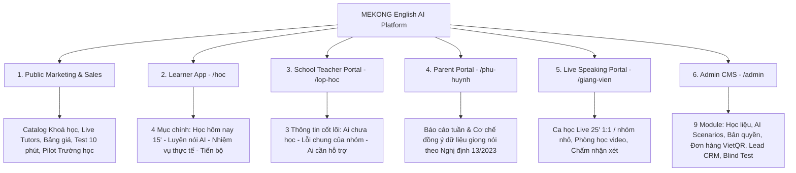

# 🌿 MEKONG English AI

> **Ứng dụng học tiếng Anh thông minh gắn với học tập, đời sống và nghề nghiệp địa phương**  
> Một sản phẩm giáo dục của **Công ty TNHH Công nghệ Mekong Green AI** (Tỉnh An Giang)

[](https://vercel.com/new/clone?repository-url=https%3A%2F%2Fgithub.com%2FDuyKhanh151097%2Fmekong-english-ai&project-name=mekong-english-ai&repository-name=mekong-english-ai)
[](https://nextjs.org/)
[](https://www.typescriptlang.org/)
[](https://tailwindcss.com/)
[](https://www.prisma.io/)
[](#)

---

## 🎯 Định vị & Sứ mệnh

- **Định vị cốt lõi:** *“Mỗi ngày 15 phút, học điều gần gũi, luyện nói có hướng dẫn và nhìn thấy tiến bộ.”*
- **Khẩu hiệu (Slogan):** *“Học gần gũi – Nói tự tin – Dùng được mỗi ngày.”*
- **Mục tiêu chiến lược:** Đồng hành cùng ngành Giáo dục tỉnh An Giang trong đề án đưa tiếng Anh trở thành ngôn ngữ thứ hai trong trường học; trước mắt tập trung vào học sinh THCS (lớp 6–7), sau đó mở rộng sang sinh viên, người làm du lịch, dịch vụ nhà hàng - lưu trú (Châu Đốc, Rừng tràm Trà Sư, Núi Sam, Phú Quốc, Hà Tiên) và cộng đồng người học lại tiếng Anh.

---

## ✨ 5 Điểm khác biệt công nghệ & sư phạm

| Điểm khác biệt | Cách triển khai cụ thể | Giá trị với người học |
|---|---|---|
| **1. Học từ những điều quen thuộc** | Bài học gắn liền với trường học, chợ nổi, món ăn, nông sản OCOP, điểm đến An Giang (Trà Sư, Núi Sam, Châu Đốc, Thoại Sơn). Học liệu số do giáo viên địa phương thẩm định. | Dễ hiểu tình huống, có cảm xúc để nói, thấy rõ mục đích học tập. |
| **2. AI điều chỉnh mức trợ giúp (Scaffolding)** | **Mức 1:** Khung câu & từ gợi ý → **Mức 2:** Chỉ gợi ý từ khóa → **Mức 3:** Hội thoại tự nhiên & câu hỏi mở rộng. Tự động giảm trợ giúp khi đạt yêu cầu 2 lượt liên tiếp. | Học sinh yếu không bị nản; học sinh khá không phải lặp lại nội dung quá dễ. |
| **3. Luyện nói hướng đến giao tiếp hiểu được** | Đánh giá 4 tiêu chí: *Ý nghĩa, Độ rõ, Từ vựng, Cấu trúc*. Mỗi lượt nói AI chỉ ưu tiên sửa **1–2 lỗi quan trọng nhất** kèm giải thích tiếng Việt. | Tránh quá tải nhận thức, giảm tâm lý sợ sai, tạo phản xạ tự nhiên. |
| **4. Học được khi kết nối không ổn định** | Tải trước bài nghe, hình ảnh và bài tập vào bộ nhớ máy; lưu bài nói ghi âm khi mạng chập chờn và tự động đồng bộ khi có kết nối trở lại. | Không phụ thuộc vào mạng mạnh hay điện thoại đắt tiền; dùng tốt tại phòng máy trường học. |
| **5. Biến bài học thành nhiệm vụ thực tế (Transfer)** | Sau mỗi chủ đề, học sinh thực hiện nhiệm vụ: tự ghi âm giới thiệu một địa điểm gần nhà, hỏi đường, trình bày sản phẩm OCOP bằng lời của chính mình. | Đánh giá chính xác khả năng vận dụng ngôn ngữ ngoài khuôn khổ bài mẫu. |

---

## 📦 3 Gói sản phẩm trên cùng một nền tảng

1. **English School (Ưu tiên phát triển đầu tiên):**
   - Học sinh THCS (trước mắt khối 6–7) theo Chương trình GDPT 2018.
   - Củng cố bài học trên lớp, tăng thời lượng nghe - nói, tích hợp cổng giáo viên theo dõi và giao bài.
2. **English Career (Mở rộng sau thí điểm):**
   - Sinh viên, người lao động tại khách sạn, nhà hàng, điểm tham quan, hướng dẫn viên du lịch, tiểu thương chợ nổi và hộ sản xuất OCOP.
   - Luyện các tình huống giao tiếp nghề nghiệp thực tế.
3. **English Community (Phát triển theo đơn vị đặt hàng):**
   - Người mới bắt đầu hoặc người lớn tuổi học lại tiếng Anh.
   - Hướng dẫn 100% bằng tiếng Việt gần gũi, bài học 5–10 phút, thao tác một chạm siêu đơn giản.

---

## 🏛️ Kiến trúc 6 Phân hệ (Portals)



### 1. Website giới thiệu & bán hàng công khai (`/`)
- Danh mục khoá học & video bài giảng chuyên sâu.
- Giới thiệu 3 gói: *English School*, *English Career*, *English Community*.
- Luyện nói trực tiếp với giáo viên (Live Speaking 25 phút/buổi).
- Dành cho nhà trường: Đề xuất dự án thí điểm 9–12 tháng.
- Bảng giá minh bạch & Cổng thanh toán (VietQR, VNPay, MoMo, ZaloPay).
- Bài kiểm tra trình độ nhanh 10 phút xếp lớp tự động.
- Trải nghiệm thử widget tương tác giới thiệu Rừng tràm Trà Sư ngay trên trang chủ.

### 2. Ứng dụng người học (`/hoc`)
Giao diện tối giản với đúng **4 mục chính**:
1. **Học hôm nay (`/hoc`):** Buổi học 15 phút theo quy trình 5 bước chuẩn sư phạm:
   - *2 phút ôn lại:* Nghe và nói lại các từ, mẫu câu còn yếu.
   - *3 phút xem & nghe:* Học qua hình ảnh bối cảnh và video hội thoại ngắn.
   - *6 phút luyện nói với AI:* Nhiệm vụ giao tiếp có mức trợ giúp thích ứng.
   - *3 phút sửa lỗi & làm bài:* Nghe mẫu chuẩn, xem giải thích tiếng Việt ngắn gọn.
   - *1 phút xem kết quả:* Nhìn thấy XP nhận được, chuỗi ngày học (streak) và gợi ý ngày mai.
2. **Luyện nói (`/hoc/luyen-noi`):** Gia sư AI thích ứng 3 mức trợ giúp (Scaffolding). Tự động nhận diện giọng nói (Web Speech API / Whisper) hoặc nhập liệu văn bản; chấm điểm 4 tiêu chí và đề xuất bước vận dụng tình huống mới gần nhà.
3. **Nhiệm vụ thực tế (`/hoc/nhiem-vu`):** Thử thách vận dụng ngoài đời thực, ghi âm bài nói, chấm theo Rubric chuẩn và giáo viên trường có thể thẩm định lại.
4. **Tiến bộ của tôi (`/hoc/tien-bo`):** Biểu đồ chuỗi ngày học, điểm kinh nghiệm (XP), lịch sử luyện nói và bảng thành tích lớp học.

### 3. Cổng Giáo viên trường học (`/lop-hoc`)
Giao diện quản lý lớp học thật gọn gàng, hiển thị ngay **3 thông tin cốt lõi**:
- 🚨 **Ai chưa tham gia:** Danh sách học sinh chưa hoàn thành buổi học trong tuần.
- ⚠️ **Nhóm đang gặp lỗi gì:** Thống kê các lỗi phát âm, ngữ pháp phổ biến nhất của lớp.
- 💡 **Ai cần hỗ trợ thêm:** Danh sách học sinh yếu cần phụ đạo hoặc điều chỉnh bài tập.
- Tính năng: Tạo lớp bằng **Mã lớp / Mã QR**, giao bài tập 1 chạm, chấm bài nói thực tế và **sửa phản hồi của AI**.

### 4. Cổng Phụ huynh học sinh (`/phu-huynh`)
- Nhận báo cáo tóm tắt hàng tuần: số buổi học hoàn thành, kỹ năng con đã nói tốt và phần cần cải thiện.
- **Bảo vệ dữ liệu & Quyền riêng tư theo Nghị định 13/2023/NĐ-CP:**
  - Bật/tắt quyền thu thập bản ghi âm luyện nói của học sinh.
  - Tuỳ chọn thời hạn lưu trữ (30 ngày, 90 ngày, hoặc xoá ngay sau khi AI chấm).
  - Cam kết không chia sẻ dữ liệu âm thanh cho bên thứ ba vì mục đích quảng cáo.

### 5. Cổng Giáo viên Live Speaking (`/giang-vien`)
- Quản lý lịch dạy ca 25 phút (1 kèm 1 hoặc nhóm nhỏ tối đa 4 học sinh).
- Nút bấm vào phòng học trực tuyến (tích hợp Google Meet / Jitsi / Zoom).
- Phiếu đánh giá sau buổi học: chấm điểm phát âm, độ trôi chảy và ghi lời khuyên cho học viên.

### 6. Quản trị hệ thống toàn diện (`/admin`)
Bao gồm 9 phân hệ quản trị mạnh mẽ:
1. `Tổng quan & Chỉ số thí điểm`: Đo lường tỷ lệ hoàn thành (CR), tỷ lệ duy trì (retention), điểm NPS.
2. `Quản lý Học liệu & Video`: Thêm khoá học, bài giảng, video clip và câu hỏi tương tác.
3. `Live Speaking & Giáo viên`: Duyệt hồ sơ giáo viên bản ngữ/Việt Nam, kiểm soát ca học và thù lao.
4. `Người dùng & Phân quyền`: Quản trị 5 nhóm vai trò, hỗ trợ đăng nhập thay (Impersonate) để hỗ trợ kỹ thuật.
5. `Trường học & Lớp thí điểm`: Quản lý danh sách trường, khối lớp và giáo viên phụ trách.
6. `Bảng giá & Đơn hàng`: Theo dõi giao dịch nạp tiền, kích hoạt gói học qua mã chuyển khoản VietQR tự động.
7. `Lead tư vấn & Phụ huynh`: CRM thu thập form liên hệ, đăng ký học thử và xếp lịch tư vấn.
8. `Quản trị Website & Blog`: Quản lý bài viết tin tức, cẩm nang học tập, cập nhật trang chủ.
9. `AI, Đánh giá Blind & Bảo mật`: Giám sát chi phí token AI trên mỗi học viên; giao diện chấm điểm đối chứng mù (Blind Pre/Post Test) giữa giáo viên và AI.

---

## ⚡ Đổi nhanh tài khoản Demo (1-Click Switcher)

Trên thanh màu đen đầu trang của mọi màn hình, bạn có thể bấm 1 nút để đổi ngay vai trò mà không cần đăng xuất và đăng nhập lại:

| Vai trò | Tài khoản | Mật khẩu | Trang bắt đầu |
|---|---|---|---|
| **Học sinh (Lớp 6A1)** | `hocsinh@mekong.ai` *(hoặc gõ `hocsinh`)* | `123456` | [`/hoc`](http://localhost:3000/hoc) |
| **Phụ huynh học sinh** | `phuhuynh@mekong.ai` *(hoặc gõ `phuhuynh`)* | `123456` | [`/phu-huynh`](http://localhost:3000/phu-huynh) |
| **Giáo viên trường** | `giaovien@mekong.ai` *(hoặc gõ `giaovien`)* | `123456` | [`/lop-hoc`](http://localhost:3000/lop-hoc) |
| **Giáo viên Live** | `tutor@mekong.ai` *(hoặc gõ `tutor`)* | `123456` | [`/giang-vien`](http://localhost:3000/giang-vien) |
| **Quản trị viên (Admin CMS)** | `admin@mekong.ai` *(hoặc gõ `admin`)* | `admin123` | [`/admin`](http://localhost:3000/admin) |

*(Học sinh cũng có thể vào nhanh phòng máy trường học bằng cách nhập mã lớp `AG6A01` tại trang [`/vao-lop`](http://localhost:3000/vao-lop))*

---

## 🛠️ Công nghệ sử dụng (Tech Stack)

- **Frontend & Backend:** [Next.js 15 (App Router)](https://nextjs.org/) với React Server Components (RSC) và Server Actions.
- **Ngôn ngữ:** [TypeScript](https://www.typescriptlang.org/) strict type check toàn diện.
- **Giao diện:** [Tailwind CSS](https://tailwindcss.com/) với bảng màu lấy cảm hứng từ thiên nhiên An Giang (xanh tràm Trà Sư `#0F9D58`, vàng lúa phù sa `#EAB308`, cam đất phù sa `#EA580C`).
- **Icons:** [Lucide React](https://lucide.dev/).
- **Cơ sở dữ liệu & ORM:** [Prisma ORM](https://www.prisma.io/) với SQLite (`prisma/dev.db`) trong môi trường phát triển (dễ dàng chuyển sang PostgreSQL cho production).
- **Xác thực phiên (Auth):** Session cookie mã hoá JWT chuẩn bằng thư viện [jose](https://github.com/panva/jose).
- **Công nghệ Giọng nói & AI:**
  - Nhận diện giọng nói phía Client qua [Web Speech Recognition API](https://developer.mozilla.org/en-US/docs/Web/API/Web_Speech_API) (kèm chế độ dự phòng gõ văn bản).
  - Đọc mẫu phát âm qua [Web Speech Synthesis API](https://developer.mozilla.org/en-US/docs/Web/API/SpeechSynthesis) với điều chỉnh tốc độ 1.0x và 0.75x.
  - Bộ máy đánh giá năng lực nói thông minh tích hợp [Google Gemini AI](https://ai.google.dev/) (gemini-2.0-flash) kèm bộ quy tắc chấm nội bộ dự phòng khi mất kết nối mạng.
- **Thanh toán:** Tích hợp mã VietQR động, hỗ trợ MoMo, ZaloPay, VNPay.

---

## 🚀 Hướng dẫn cài đặt & Khởi chạy

### Yêu cầu môi trường
- [Node.js](https://nodejs.org/) phiên bản 18.18 trở lên hoặc 20.x
- npm hoặc pnpm

### Các bước thực hiện

```bash
# 1. Clone repository về máy
git clone https://github.com/DuyKhanh151097/mekong-english-ai.git
cd mekong-english-ai

# 2. Cài đặt các thư viện phụ thuộc
npm install

# 3. Tạo tệp cấu hình môi trường từ mẫu
cp .env.example .env

# 4. Khởi tạo cơ sở dữ liệu SQLite và nạp dữ liệu mẫu địa phương An Giang
npm run setup

# 5. Khởi chạy máy chủ phát triển
npm run dev
```

Mở trình duyệt tại **`http://localhost:3000`** để bắt đầu trải nghiệm!

### Các lệnh hữu ích khác

```bash
# Kiểm tra lỗi kiểu dữ liệu TypeScript
npm run typecheck

# Mở giao diện trực quan quản lý cơ sở dữ liệu Prisma Studio
npm run db:studio

# Biên dịch ứng dụng cho môi trường Production
npm run build

# Chạy bản build Production
npm start
```

---

## 📊 Kế hoạch Thí điểm 9–12 Tháng tại An Giang

Được thiết kế bài bản theo tiêu chuẩn nghiên cứu thực nghiệm giáo dục:
- **Giai đoạn 1 (Tháng 1–3):** Hoàn thiện sản phẩm, số hóa học liệu địa phương và tổ chức tập huấn cho giáo viên.
- **Giai đoạn 2 (Tháng 4–7):** Thí điểm tại 4–6 trường THCS (khoảng 300–500 học sinh khối 6–7) tại TP. Long Xuyên, TP. Châu Đốc và huyện Tri Tôn/Tịnh Biên.
- **Giai đoạn 3 (Tháng 8–10):** Đánh giá đối chứng mù (Blind Pre/Post Test) giữa nhóm sử dụng app bổ trợ và nhóm học theo phương pháp truyền thống; kiểm tra mức độ thống nhất giữa AI và giáo viên.
- **Giai đoạn 4 (Tháng 11–12):** Hoàn thiện báo cáo nghiệm thu gửi Sở Giáo dục & Đào tạo tỉnh An Giang; đề xuất mở rộng sang các trường THCS toàn tỉnh và gói du lịch.

---

## 🔒 Cam kết Bảo mật & Bản quyền (Decree 13 Compliance)

1. **Dữ liệu giọng nói của học sinh:** Được lưu trữ theo quy chuẩn mã hoá, chỉ phục vụ mục đích học tập và phản hồi sư phạm; tuân thủ quy trình xin ý kiến phụ huynh theo Nghị định 13/2023/NĐ-CP.
2. **Học liệu số địa phương:** Tất cả hình ảnh (Trà Sư, Chợ nổi, Miếu Bà Chúa Xứ, ẩm thực...) và bài đọc đều được ghi rõ nguồn, có mã thẩm định của tổ chuyên môn giáo viên tiếng Anh địa phương.
3. **Phòng máy trường học:** Tích hợp tính năng đăng xuất an toàn sau mỗi buổi học và cảnh báo phiên dùng chung để bảo vệ tài khoản cá nhân của học sinh.

---

## 📞 Liên hệ & Hợp tác

- **Đơn vị phát triển:** Công ty TNHH Công nghệ Mekong Green AI
- **Địa chỉ:** Tỉnh An Giang, Việt Nam
- **Email:** `contact@mekong.ai` | `admin@mekong.ai`
- **Hotline hỗ trợ:** 1900 6868
- **Website:** [https://mekongenglish.ai](https://mekongenglish.ai)

---

*Bản quyền © 2026 thuộc về Công ty TNHH Công nghệ Mekong Green AI. Mọi quyền được bảo lưu.*
